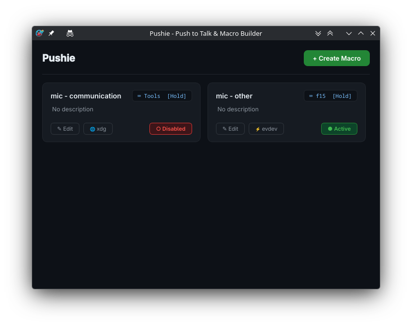

# Pushie



Pushie is a modern PySide6-based macro builder. It couples push-to-talk microphone management with keyboard/mouse automation using the native **XDG Global Shortcuts portal** over DBus.

## Features

- **XDG Global Shortcuts Portal Integrations**: Works natively under Wayland/X11 without requiring root access or unsafe key logging. Compatible with sandboxed containers (Flatpak/Snap).
- **Macro Editor UI**: Create, reorder, edit, and delete lists of actions.
- **Action Categories**:
  - **Keyboard**: Press, release, and tap keys.
  - **Mouse**: Click (left/middle/right/wheel buttons) and coordinate-based movements.
  - **Delay**: Milli-second duration pauses.
  - **Mic Controls**: Custom mute toggles and specific process target volume profiles (e.g. `discord`, `vesktop`).
- **Daemon Mode**: Minimizes to the system tray, keeping hotkeys active in the background.
- **Auto-Cleanup**: On app termination or standard terminal `Ctrl+C` interrupt, running macros automatically run their release/unmute action lists before exiting.
- **Launch Configurations**: CLI parameter `--minimized` to boot straight to the system tray.

---

## Compatibility

**Prebuilt binary** (from the [releases page](https://github.com/lyuksovannyy/pushie/releases)): x86_64 Linux with glibc 2.39 or newer, e.g. Ubuntu 24.04+, Debian 13+, Fedora 40+, Arch. It is built on Ubuntu 24.04; on older distributions, build from source instead.

**Desktop environments.** Developed and tested on KDE Plasma 6 (Wayland). Other desktops depend on the feature:

| Feature | Requirement |
| --- | --- |
| XDG hotkeys (default bind method) | A desktop that implements the GlobalShortcuts portal: KDE Plasma 5.27+, GNOME 48+, Hyprland |
| Evdev hotkeys | Any desktop; needs read access to `/dev/input` (see below) |
| Per-app macro activation | Hyprland (`hyprctl`), Sway (`swaymsg`), KDE Plasma Wayland (`kdotool`), GNOME (`gdbus`), X11 (`xdotool` or `xprop`) |
| Keyboard / mouse actions | `xdotool`, so they reach X11 and XWayland windows only |
| Mic controls | `pactl` (PulseAudio or PipeWire with `pipewire-pulse`) |

---

## Installation & Setup

Pushie requires PySide6, PyYAML, dbus-python, and PyGObject.

Ensure you have the required system and Python dependencies installed. We recommend using `uv` to manage environment requirements:

```bash
# Run developers mode via uv
uv run main.py
```

### Optional: Evdev Input Registration Setup
By default, Pushie uses the **XDG Global Shortcuts portal** which works out of the box but is swallowed by your desktop compositor. If you want to use the **Evdev key bind method** (allowing hotkeys to pass through directly to games and apps), you must grant your user read access to `/dev/input/event*` devices without root permissions.

Add your user to the `input` group:
```bash
sudo usermod -aG input $USER
```
*Note: You must log out of your desktop session and log back in (or reboot) for this change to take effect.*

### Command Line parameters
Start minimized to tray directly:
```bash
uv run main.py --minimized
```

---

## How to Build & Install Standalone Application

### 0. Install build dependencies:
`dbus-python` and `PyGObject` are compiled during install, and the bundler needs the GLib introspection typelibs:
```bash
# Debian / Ubuntu (24.04+)
sudo apt install build-essential pkg-config libdbus-1-dev libglib2.0-dev libgirepository-2.0-dev libcairo2-dev gir1.2-glib-2.0 gir1.2-girepository-3.0

# Fedora
sudo dnf install gcc pkgconf-pkg-config dbus-devel glib2-devel gobject-introspection-devel cairo-gobject-devel

# Arch
sudo pacman -S base-devel dbus glib2 gobject-introspection cairo
```

### 1. Compile into stand-alone binary:
Execute the bundle shell script which creates a single binary of Pushie with built-in asset dependencies and the custom launcher icon styling:
```bash
./build.sh
```
This produces the standalone binary at: `./dist/pushie`

### 2. Install and register:
Run the install script. It offers to copy `dist/pushie` to `/usr/bin` (asks for sudo) and to register the desktop launcher and icon:
```bash
./register-app.sh
```

---

## Configuration directory

Macros are stored individually as YAML configurations:
- Primary: `$HOME/.config/pushie/<macro_id>.yaml`
- Fallback: `$HOME/.pushie/<macro_id>.yaml`

---

## Testing

```bash
uv run python3 -m unittest tests/test_storage.py tests/test_engine.py tests/test_xdg_shortcuts.py
```
